<div align="center">
  <strong></strong>

  # 🏥 DrBinati MedAssist: AI-Powered Multi-Modal Medical Analysis

  _By **BINATI AInalytics**_
</div>

A research prototype that analyses ECG signals, medical images, and clinical notes together — using Claude or GPT-4 Vision — and synthesises 
the three modalities into a single clinical narrative, enriched with retrieval over previously analysed cases.

> ⚠️ **Research prototype. Not for clinical use.** See [Disclaimer](#-disclaimer).

# Screenshots
<details>
<summary>Click to view application screenshots</summary>

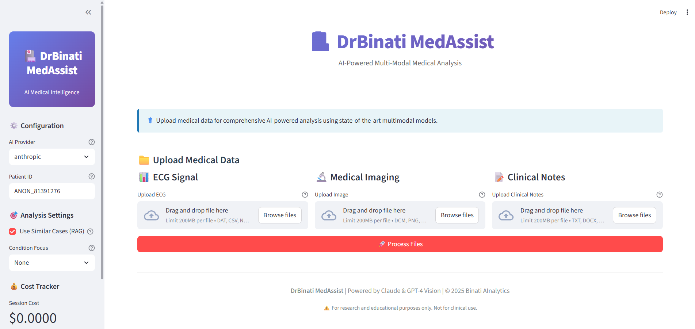
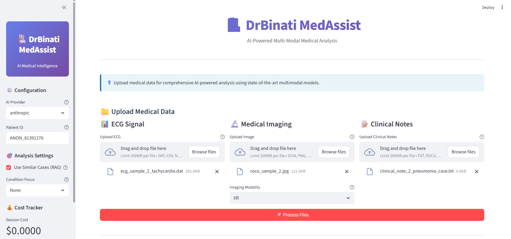
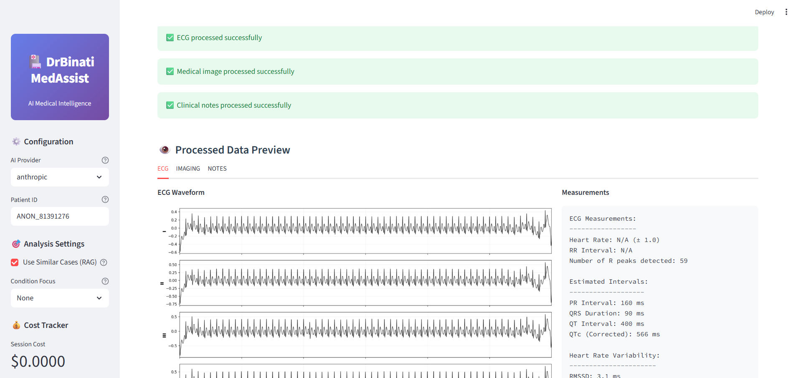
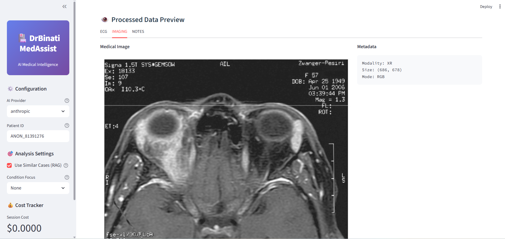
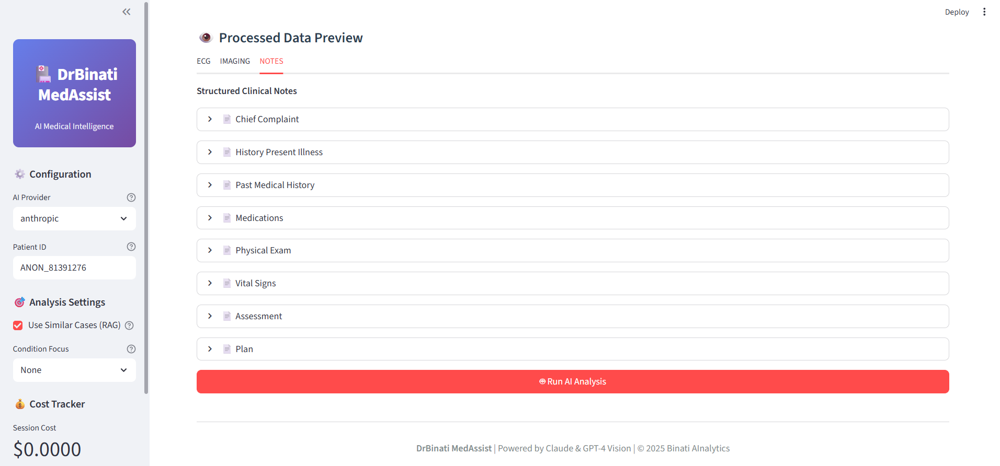
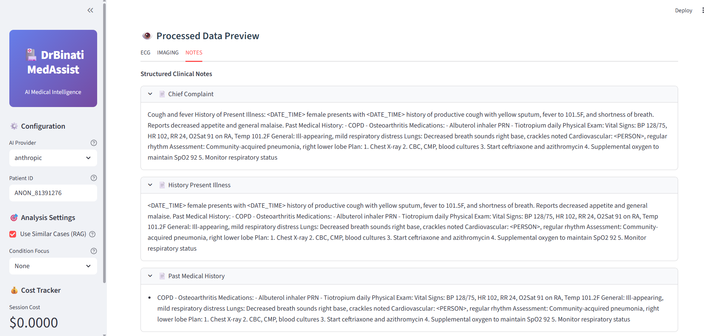
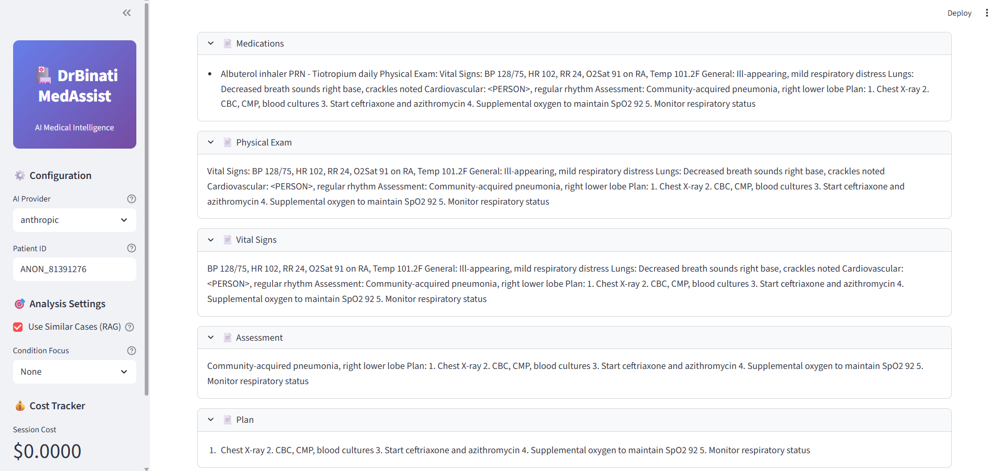
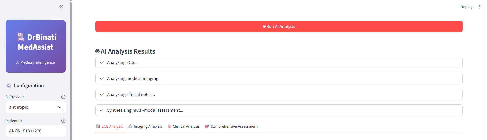
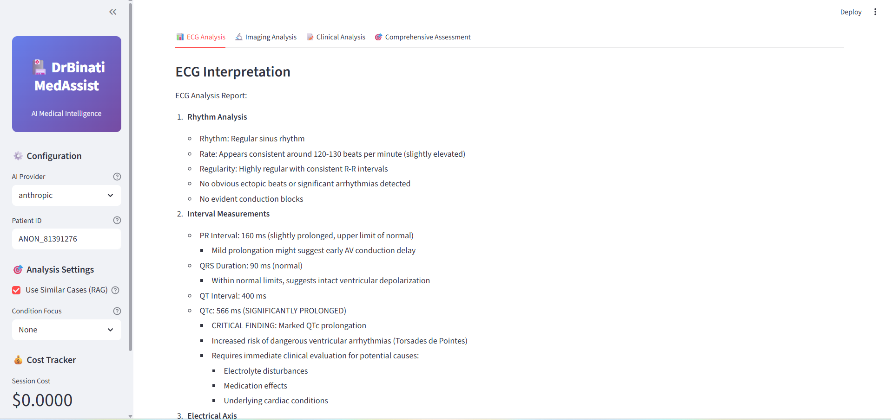
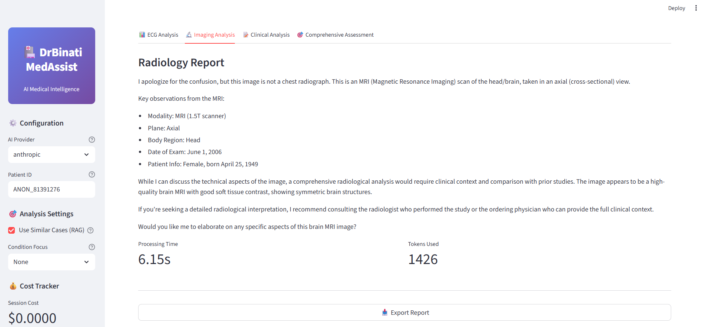
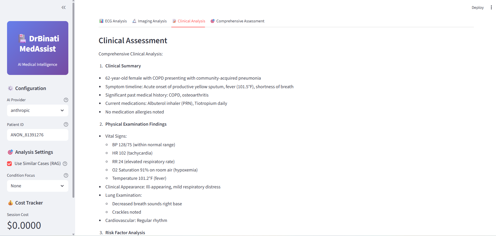
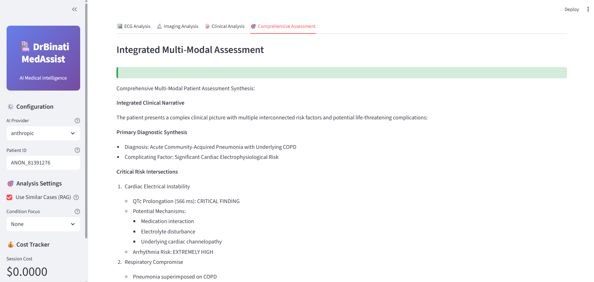
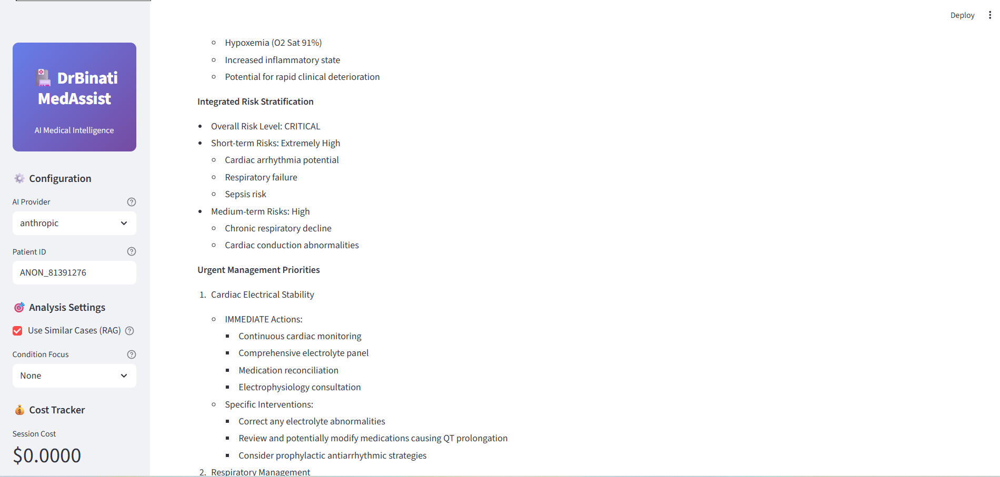
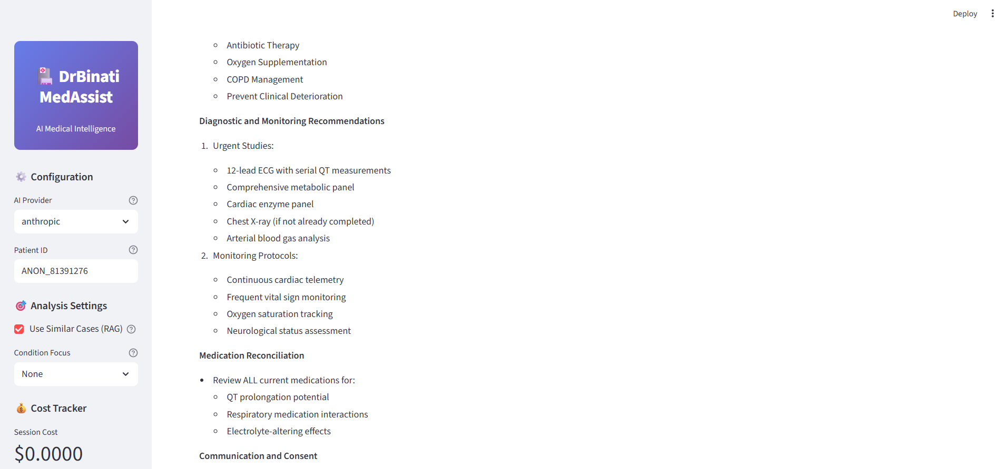
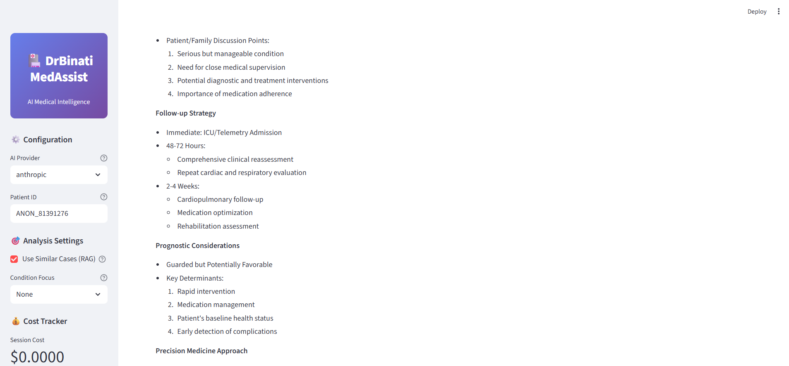
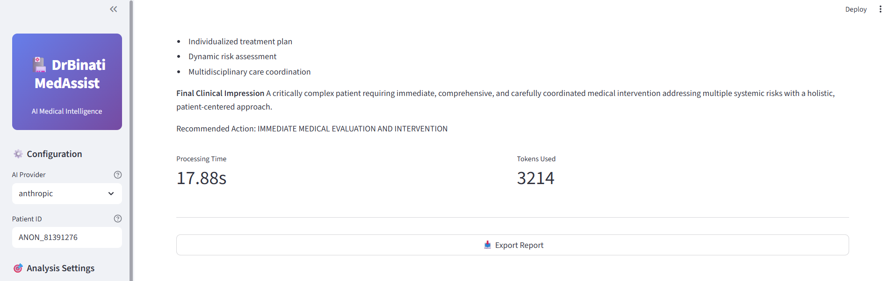
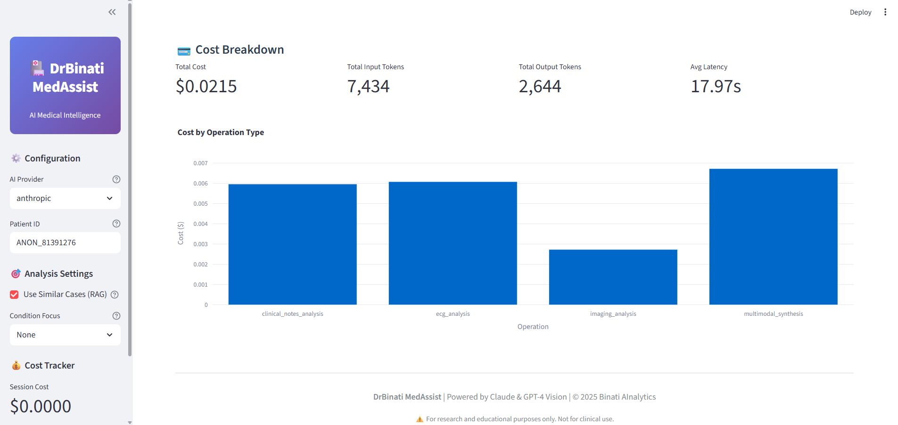

</details>

---

## 📖 Overview

Clinicians rarely reach a conclusion from one data source. A suspected myocardial
infarction is read from the ECG *and* the chest film *and* the presenting history.
Most medical AI tooling, however, is single-modality: an ECG classifier, an image
captioner, a notes summariser — each blind to the others.

DrBinati MedAssist takes the opposite approach. Each modality is processed by a
dedicated pipeline, analysed with a condition-specific prompt, and then passed to a
synthesis step that reasons across all of them at once. A retrieval-augmented
generation (RAG) layer surfaces similar historical cases from the local database so
that the synthesis is grounded in prior context rather than the current case alone.

# Dissertation summary

> This dissertation presents DrBinati MedAssist, a comprehensive multi-modal artificial intelligence system designed for integrated analysis of heterogeneous medical data. The system combines electrocardiogram (ECG) signals, medical imaging, and clinical notes to provide synthesized diagnostic insights using state-of-the-art large language models (LLMs) and vision-language models (VLMs).

> Electrocardiography represents one of the most widely used diagnostic tools in cardiology, with over 300 million ECG recordings performed annually worldwide. 

> Traditional ECG interpretation requires specialized training and expertise, with inter-observer variability ranging from 5-20% even among experienced cardiologists.

 > Medical imaging encompasses diverse modalities including X-ray radiography, computed tomography (CT), magnetic resonance imaging (MRI), ultrasound, and nuclear medicine. Each modality provides unique physiological and anatomical information, requiring specialized interpretation skills.

> Clinical documentation forms the narrative backbone of patient care, capturing symptoms, physical examination findings, diagnostic reasoning, and treatment plans in natural language. Electronic health records (EHRs) have digitized this information, enabling computational analysis while introducing challenges related to inconsistent formatting, abbreviations, and medical jargon. 

> Multi-modal learning aims to build models that process and relate information from multiple modalities, potentially improving predictive performance and robustness compared to single-modality approaches.


**What it does:**

- Reads 12-lead ECG recordings (WFDB, CSV, NumPy, raw `.dat`) and derives rhythm,
  rate, and morphology features plus waveform/spectrogram renderings
- Reads medical images (DICOM, JPEG, PNG) with metadata anonymisation, windowing,
  normalisation, and CLAHE contrast enhancement
- Reads free-text clinical notes with PHI de-identification (Presidio), section
  extraction, and structured parsing
- Sends each to Claude or GPT-4 Vision using prompts specialised per condition
  (acute MI, arrhythmia, oncology, emergency triage, …)
- Retrieves similar past cases via vector similarity search and synthesises a
  cross-modal assessment
- Tracks token usage and cost for every call, with budget alerting

---

## ✨ Features

### Multi-Modal Processing

| Modality | Processor | Capabilities |
|----------|-----------|--------------|
| ECG | `ecg_processor.py` | WFDB/CSV/NumPy/raw loading, R-peak detection, HR & interval extraction, waveform + spectrogram plots |
| Imaging | `image_processor.py` | DICOM parsing & anonymisation, windowing, normalisation, CLAHE enhancement, base64 encoding for vision APIs |
| Clinical Notes | `clinical_processor.py` | Presidio de-identification, section extraction (CC/HPI/PMH/Meds/Exam/A&P), vitals & medication parsing |

### AI Analysis

- **Dual provider**: switch between Anthropic and OpenAI with a single flag
- **Condition-specific prompts**: `medical_prompts.py` holds specialised prompt
  templates for ECG (general / acute MI / arrhythmia), imaging (chest X-ray / CT /
  oncology), clinical notes (general / cardiology), and multi-modal synthesis
  (general / emergency)
- **Cost tracking**: per-operation token and dollar accounting, surfaced in both the
  CLI summary and the Streamlit sidebar

### RAG System

- PostgreSQL + `pgvector` for vector similarity search over prior analyses
- Medical-domain embeddings for semantically meaningful retrieval
- Similar-case context injected into the synthesis prompt
- Full audit trail of every analysis persisted to the database

### Streamlit UI

- Upload-and-analyse workflow requiring no programming knowledge
- Separate tab per modality plus a combined synthesis view
- Live cost tracker and Markdown report export

---

## 🏗️ Architecture

```
                 ┌──────────────┐  ┌──────────────┐  ┌──────────────┐
   Input         │   ECG file   │  │Medical image │  │Clinical notes│
                 └──────┬───────┘  └──────┬───────┘  └──────┬───────┘
                        │                 │                 │
                 ┌──────▼───────┐  ┌──────▼───────┐  ┌──────▼───────┐
   Processing    │ ECGProcessor │  │ImageProcessor│  │  Clinical    │
                 │              │  │  (+ DICOM    │  │NotesProcessor│
                 │              │  │  anonymise)  │  │  (+ de-id)   │
                 └──────┬───────┘  └──────┬───────┘  └──────┬───────┘
                        └────────┬────────┴────────┬────────┘
                                 │                 │
                        ┌────────▼─────────────────▼────────┐
   Analysis             │       MultiModalAnalyzer          │
                        │  Claude / GPT-4V + MedicalPrompts │
                        └────────────────┬──────────────────┘
                                         │
                        ┌────────────────▼──────────────────┐
   Retrieval            │   MultiModalRAG  (pgvector)       │
                        │   similar case retrieval          │
                        └────────────────┬──────────────────┘
                                         │
                        ┌────────────────▼──────────────────┐
   Synthesis            │     MultiModalOrchestrator        │
                        │  cross-modal synthesis + costs    │
                        └────────────────┬──────────────────┘
                                         │
                        ┌────────────────▼──────────────────┐
   Output               │  Streamlit UI  |  CLI  |  JSON    │
                        └───────────────────────────────────┘
```

---

## 🚀 Installation

**Requirements:** Python 3.10+, 8 GB RAM (16 GB recommended), ~10 GB disk if you
intend to download the full ROCO dataset.

### Option 1: Setup Script (Recommended)

```bash
cd multimodal-healthcare-ai

chmod +x setup.sh
./setup.sh
```

The script creates a virtual environment, installs `requirements.txt`, pulls the
clinical NLP model, copies `.env.example` to `.env`, and creates the `data/` and
`logs/` directories.

Then add your API key:

```bash
nano .env
# ANTHROPIC_API_KEY=sk-ant-...
# or
# OPENAI_API_KEY=sk-...
```

And launch the UI:

```bash
source venv/bin/activate
streamlit run ui/streamlit_app.py
```

### Option 2: Docker

Brings up the app plus a `pgvector`-enabled PostgreSQL instance:

```bash
cp .env.example .env
nano .env                 # add API keys

docker-compose up -d
```

Access the UI at <http://localhost:8501>. The database is exposed on `5432` and
`./data` / `./logs` are bind-mounted so results survive container restarts.

### Option 3: Manual

```bash
python -m venv venv

source venv/bin/activate          # Linux/macOS
venv\Scripts\activate             # Windows

pip install --upgrade pip
pip install -r requirements.txt

cp .env.example .env              # then edit in your API keys
```

---

## ⚡ Quick Start

### Streamlit UI

```bash
streamlit run ui/streamlit_app.py
```

Upload any file from `data/test_samples/` to try it immediately — no setup beyond an
API key required. See [TEST_DATA_READY.md](TEST_DATA_READY.md) for what's included.

### Command Line

```bash
python main.py \
  --patient-id PATIENT_001 \
  --ecg data/test_samples/ecg/ecg_sample_5_st_elevation.dat \
  --image data/test_samples/medical_imaging/roco_sample_1.jpg \
  --notes data/test_samples/clinical_notes/clinical_note_1_acute_mi_case.txt \
  --api anthropic \
  --condition acute_mi \
  --output ./output
```

Results are written to `./output/<patient-id>_analysis.json` and a summary
(modalities analysed, similar cases retrieved, total cost, synthesis text) is
printed to stdout.

**Available flags:**

| Flag | Default | Description |
|------|---------|-------------|
| `--patient-id` | *required* | Anonymous patient identifier |
| `--ecg` | — | Path to an ECG file (`.dat`, `.csv`, `.npy`) |
| `--image` | — | Path to a medical image |
| `--image-modality` | `XR` | Imaging modality (`XR`, `CT`, `MR`, `US`) |
| `--notes` | — | Path to a clinical notes text file |
| `--api` | `anthropic` | Provider: `anthropic` or `openai` |
| `--condition` | — | Condition focus, e.g. `acute_mi`, `arrhythmia` |
| `--no-rag` | off | Disable similar-case retrieval |
| `--output` | `./output` | Directory to write results to |

At least one of `--ecg`, `--image`, `--notes` must be supplied.

### Python API

```python
from src.multimodal.analyzers.multimodal_analyzer import MultiModalAnalyzer

analyzer = MultiModalAnalyzer(api_choice='anthropic')

result = analyzer.analyze_ecg(processed_ecg_data, condition_focus='acute_mi')
print(result['analysis'])
```

### Notebook

`notebooks/quickstart.ipynb` walks through the ROCO dataset, single-modality
analysis, and full multi-modal synthesis interactively.

---

## 📊 Data

**Test samples** (`data/test_samples/`) — 25 files ready to use out of the box:
5 synthetic 12-lead ECGs, 5 clinical notes, 5 ROCO images, plus JSON metadata
sidecars. See [docs/TEST_DATA_GUIDE.md](docs/TEST_DATA_GUIDE.md).

**ROCO dataset** (`data/roco/`) — 81,807 real radiology images with expert captions,
downloaded from Kaggle. Optional, ~7.1 GB. See
[DOWNLOAD_GUIDE.md](DOWNLOAD_GUIDE.md).

---

## 📁 Project Structure

```
multimodal-healthcare-ai/
├── config/
│   └── settings.py                     # Pydantic settings, loaded from .env
├── src/
│   ├── multimodal/
│   │   ├── processors/
│   │   │   ├── ecg_processor.py
│   │   │   ├── image_processor.py
│   │   │   ├── clinical_processor.py
│   │   │   └── roco_loader.py
│   │   ├── analyzers/
│   │   │   ├── multimodal_analyzer.py  # Claude / GPT-4V calls + cost tracking
│   │   │   └── rag_system.py           # RAG retrieval + orchestrator
│   │   └── prompts/
│   │       └── medical_prompts.py      # Condition-specific prompt library
│   └── database/
│       ├── models.py                   # SQLAlchemy models (pgvector)
│       └── database.py                 # Session/engine management
├── ui/
│   └── streamlit_app.py                # DrBinati MedAssist dashboard
├── scripts/
│   ├── download_roco.py                # Kaggle ROCO downloader
│   ├── generate_test_data.py           # Synthetic test data generator
│   ├── batch_analyze_roco.py           # Bulk ROCO analysis
│   ├── test_roco_integration.py
│   └── test_random_sampling.py
├── data/
│   ├── roco/                           # ROCO dataset (downloaded)
│   └── test_samples/                   # 25 ready-to-use test files
├── notebooks/
│   └── quickstart.ipynb
├── docs/
│   ├── ROCO_INTEGRATION.md
│   ├── TEST_DATA_GUIDE.md
│   └── STREAMLIT_UI_PREVIEW.md
├── dissertation/                       # MSc dissertation + appendices
├── main.py                             # CLI entry point
├── requirements.txt
├── Dockerfile
├── docker-compose.yml
└── setup.sh
```

---

## 💰 Cost

Typical per-analysis cost with Claude 3.5 Sonnet:

| Analysis Type | Cost | Latency |
|---------------|------|---------|
| ECG only | $0.015 | 5–8 s |
| Imaging only | $0.012 | 6–10 s |
| Clinical notes only | $0.018 | 4–7 s |
| **Complete multi-modal** | **$0.04–0.05** | **30–60 s** |

Claude 3.5 Haiku brings image analysis down to roughly $0.003 each, which is the
sensible default for bulk ROCO runs. Budget limits and an 80% alert threshold are
configurable in `.env` (`DAILY_API_BUDGET`, `MONTHLY_API_BUDGET`,
`ALERT_THRESHOLD`).

---

## 📚 Documentation

| Document | Contents |
|----------|----------|
| [PROJECT_SUMMARY.md](PROJECT_SUMMARY.md) | Full feature inventory, workflows, roadmap, troubleshooting |
| [DOWNLOAD_GUIDE.md](DOWNLOAD_GUIDE.md) | Downloading and verifying the ROCO dataset |
| [ROCO_SETUP_COMPLETE.md](ROCO_SETUP_COMPLETE.md) | Post-download state, CSV schema, batch analysis |
| [TEST_DATA_READY.md](TEST_DATA_READY.md) | Test data suite status and quick usage |
| [docs/TEST_DATA_GUIDE.md](docs/TEST_DATA_GUIDE.md) | Detailed technical guide to the test data |
| [docs/ROCO_INTEGRATION.md](docs/ROCO_INTEGRATION.md) | `ROCODataset` API reference and examples |
| [docs/STREAMLIT_UI_PREVIEW.md](docs/STREAMLIT_UI_PREVIEW.md) | UI walkthrough |
| [dissertation/](dissertation/) | MSc dissertation, chapters, and appendices |

---

## 🔒 Security & Privacy

- PHI de-identification via Presidio on all clinical text
- DICOM metadata stripped before any image leaves the machine
- Anonymous patient identifiers only
- API keys read from `.env`, which is git-ignored and must never be committed
- Full audit trail of analyses persisted to the database

For any deployment beyond local research use, add authentication, enable database
encryption at rest, terminate TLS, and use a HIPAA-eligible API route (e.g. AWS
Bedrock) with an appropriate Business Associate Agreement in place.

---

## ⚠️ Disclaimer

DrBinati MedAssist is a **research prototype developed for educational and research
purposes**. It has **not** been validated for clinical use and should **not** be used
for patient care or medical decision-making without appropriate clinical validation,
regulatory approval, and human oversight.

All medical interpretations generated by the system require verification by qualified
medical professionals. The system is intended to demonstrate the technical
feasibility of multi-modal medical AI, not to replace human clinical judgement.

It is not FDA approved, not CE marked, and carries no regulatory clearance of any
kind.

---

## 📄 License

MIT License — free to use for research and education. See `LICENSE`.

---

**DrBinati MedAssist** | Powered by Claude & GPT-4 Vision | © 2026 Binati AI
